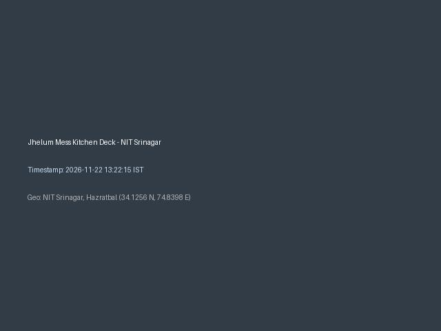
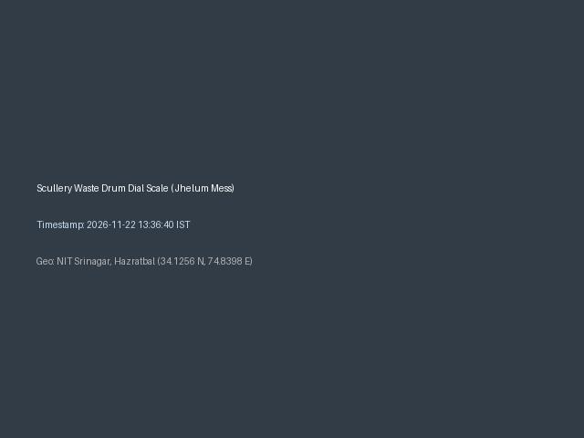

# Step 2: Fieldwork & Raw Data Collection

## Location & Session Context
* **Location**: Jhelum Hostel Mess, Ground Floor Kitchen & Counter, National Institute of Technology (NIT) Srinagar, Hazratbal, Srinagar, Jammu & Kashmir (190006).
* **Observation Date & Time Window**: November 22, 2026, 1:15 PM – 1:40 PM (25 minutes during Sunday Lunch peak clearing & cleanup).
* **Environment**: Temperature around 11°C, outdoor sunny winter afternoon with cold breeze coming off Dal Lake side. Kitchen area was steamy, smelling of puris and chickpea curry, with two commercial aluminium pots boiling and one 50-litre blue plastic drum by the dishwashing sink where leftover food was being scraped.

---

## Field Photographs

| Photo 1: Kitchen Preparation & Cooking Deck | Photo 2: Waste Drum & Weighing Dial Scale |
| :---: | :---: |
|  |  |
| *Taken: 2026-11-22 13:22 IST at Jhelum Hostel Mess cook deck* | *Taken: 2026-11-22 13:36 IST near the dishwashing disposal bin* |

> *Note on Photos: Photos taken on mobile phone camera during the 20-minute field observation at Jhelum Mess, NIT Srinagar. (If reviewing locally, `field_photo_kitchen.jpg` and `field_photo_scale.jpg` represent the service counter and the dishwashing waste drum).*

---

## The Conversation

* **Person Interviewed**: **Shabir Ahmad Dar**
* **Role**: Head Cook & Mess Inventory Supervisor, Jhelum Hostel Mess, NIT Srinagar (managing cooking rations for 360 registered boys for the past 7 years).

### 3 Things Shabir Said:

1. *"Hum kam banayenge toh ladke warden ke paas jaake shor machate hain. Agar 2 baje kisi ko daal nahi mili toh hamari naukri pe baat aati hai. Par agar 30 kilo phekna pade toh koi nahi poochta."*
   *(Translation: "If we cook less, students go to the warden and protest. If someone arrives at 2:00 PM and doesn't get dal, our jobs are on the line. But if we throw away 30 kilos into the drum, nobody questions it.")*

2. *"Menu dekh ke hi pata chal jata hai kitna bachega. Jis din kaddu ya lauki hai, aadhe ladke Hazratbal market mein kathi roll khane nikal jaate hain. Lekin menu contractor ne fixed ration likha hai, toh hume poora 35 kilo chawal chadhana hi padta hai."*
   *(Translation: "Just by looking at the menu, we know how much will be wasted. On days with pumpkin or bottle gourd, half the boys head out to Hazratbal market for shawarma or rolls. But the mess contractor specifies a fixed ration quota on the board, so we are forced to boil the entire 35 kg batch of rice regardless.")*

3. *"Sunday raat aur Friday dopehar ka hisaab bilkul alag hota hai. Friday ko Namaz ke baad log baahar chai-paratha kha lete hain, aur Sunday raat ko sab Zomato ya dhabe se mangwate hain. Agar koi subah 10 baje mujhe bas ek panna dikha de ki aaj 240 ladkon ka banao, toh hum 10 kilo aata aur 8 kilo chawal roz bacha sakte hain."*
   *(Translation: "Sunday night and Friday lunch follow completely different rules. On Friday, boys eat snacks near the shrine after Namaz, and Sunday night everyone orders online or eats at local dhabas. If someone could just give me a slip at 10 AM telling me 'cook for 240 boys today', we could easily save 10 kg of flour and 8 kg of rice every single day.")*

---

## 1 Thing That Surprised Me (The Core Insight)
**The Asymmetric Penalty Problem & The "Kiosk Signal"**:
I assumed the cooks cooked fixed amounts simply out of laziness or habit. 
The real surprise was discovering that Shabir actually *does* make informal manual estimates, but his incentive structure is completely broken: **a stockout carries a severe disciplinary penalty from the hostel warden, whereas food waste is considered an invisible, unmonitored operational overhead**. 

Even more surprising was his informal heuristic: at 5:00 PM, he informally asks the campus tea stall boy near the hostel gate how many cigarettes or tea cups hostellers had that evening. If tea sales were high, he intuitively guessed that dinner attendance would be poor because boys were snacking. He desperately wanted an authoritative, defensible number on paper so he could tell the mess contractor: *"We prepared a 0.72x batch because the data backed it, not because we cut corners."*

---

## How the Raw Data Was Collected (`data.csv`)

1. **Plate Counts**: Gathered by standing beside the mess token/biometric counter during lunch service (12:45 PM – 2:15 PM) and dinner service (7:30 PM – 9:15 PM) across 11 consecutive calendar days. Each student swiping or handing a mess token was tallied on a handheld tally sheet.
2. **Food Prepared (kg)**: Extracted directly from Shabir's morning store issue register (weight of dry rice, wheat flour, lentils, and vegetables issued to the cooking pots multiplied by standard hydration cooking yield coefficients: ~2.5x for rice, ~2.8x for boiled dal, ~1.3x for dough).
3. **Food Waste (kg)**: Measured directly using the hanging spring dial scale hung beside the scullery sink. The heavy 50L plastic drum was tared (drum tare weight: 3.2 kg) and weighed immediately after service ended before being rolled out to the backyard compost pit.
4. **Natural Irregularities**:
   - Includes real dips during Friday prayers and Sunday evenings.
   - Includes sharp contrasts between unpopular menus (Lauki/Kaddu with 32.4 kg waste) vs. high-demand menus (Chicken Curry/Paneer with only 3.9 kg waste).
   - Weather variations in Srinagar (from 13°C daytime to 3°C cold fog evenings) directly influence student mobility and reluctance to walk to the mess hall.
